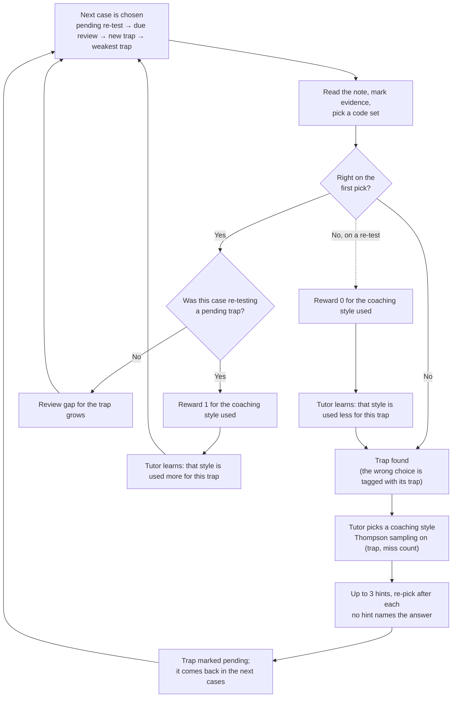

# CRC Coding Tutor

A free, non-commercial practice tool for **CRC (risk adjustment) coding** candidates. A rules engine
decides every answer; a Thompson-sampling bandit chooses *how to teach* after a wrong answer.

> CRC (Certified Risk Adjustment Coder) is a credential of AAPC. This project is not affiliated with or
> endorsed by AAPC, AHIMA, AMA or CMS. All decision tables and generated
> scenarios are **drafts** until reviewed by a certified coder. Not for production coding.

## Setup (Windows / PowerShell)

Requires Python 3.13.

```powershell
python -m venv .venv
.\.venv\Scripts\python.exe -m pip install -e ".[dev]"   # package + pytest + ruff

coding-tutor-fetch        # download CMS files into data\raw\ (not committed)
coding-tutor-build-db     # build data\codes.sqlite
coding-tutor-check        # check every decision table
coding-tutor-experiment   # compare teaching policies in the simulator
```

Each command is also available as a module, e.g. `python -m coding_tutor.engine.rules`.

## Practice (web UI, coach mode)

```powershell
coding-tutor-export-ui    # scenarios + rules engine -> web\data\bundle.json
coding-tutor-serve        # opens http://127.0.0.1:8765
```

The UI is static HTML/CSS/JS (no build step, no dependencies, no LLM at runtime). It can be hosted
on any static host. Progress stays in the student's browser.

- **Read like an auditor:** a highlighter (`M`) marks the sentences that decide the codes; the debrief
  scores how many deciding details you found.
- **Coached, not told:** a wrong pick unlocks up to 3 escalating hints (rule refresher, contrast pair,
  find the evidence, guiding question, walkthrough, narrow it down) with a re-pick after each. No hint
  names the correct code; the answer appears only if you ask.
- **Adaptive:** a Thompson-sampling bandit picks the coaching style per (trap, miss count) and learns
  from the next NEW case with the same trap. Spaced review brings traps back.
- **Know your lean:** overcoding vs undercoding meter, evidence eye, trap map, "what helps you".
- **Why it matters:** the debrief shows how the miss moves the CMS-HCC V28 risk score (feedback only).

### How the next case is chosen



Re-picks after hints never count as the reward; only the first pick on the NEW case does. The same flow
is drawn natively (no Mermaid library, works offline) on the home page.

### Live bandit API (on by default): the tutor learns from every student

The UI and the API run together on one origin, exactly like a Vercel deployment:

```powershell
coding-tutor-serve                 # http://127.0.0.1:8765 ; API at /api/v1/... ; SQLite at data\api.sqlite
coding-tutor-serve --no-api        # static UI only; the page then works offline
```

`web/config.json` defaults to `{"api": "/api"}` (same origin). If the API cannot be reached, the app keeps
working offline and each browser learns alone. Use `{"api": null}` to switch sharing off for a deployment,
or run the API alone (`coding-tutor-api`, port 8780) with `{"api": "http://127.0.0.1:8780"}`.

- The browser still chooses the coaching style. It combines the student's own results with the shared
  counts from `GET /v1/policy`, capped at 20 pseudo-trials per arm so personal results still matter.
- When a reward settles (next NEW case with the same trap), it sends `POST /v1/events` with exactly
  `{confusion, miss_level, action, reward}`. No ids, answers, notes or IPs are stored; days are the finest time grain.
- Students can turn sharing off in Progress → Learning together. Unsent events wait in an outbox.
- Server: standard-library WSGI (`coding_tutor.live.app.make_app`), CORS allowlist, 64 KB body limit,
  per-client rate limit. Storage is pluggable (`live/stores/`): SQLite now, a hosted store for deployment.

JavaScript tests live in `tests/web/` (Node's built-in runner: `node --test "tests/web/*.test.mjs"`) and also run inside `pytest`.

Resolve a single case:

```powershell
coding-tutor-check diabetes_complications dm_type=type2 complication=ckd_stage4 provider_says_unrelated=no meds=insulin
```

## Generate practice scenarios

Uses a local LLM through [Ollama](https://ollama.com) by default (model `gemma4:e4b`):

```powershell
coding-tutor-generate --n 2                          # 2 per table
coding-tutor-generate --all                          # every slot combination once
coding-tutor-generate --table ckd_staging --dry-run  # print prompts only
```

### Choosing the model

The client lives in `coding_tutor.llm` (providers: `ollama`, and `openai` for any OpenAI-compatible
`/chat/completions` endpoint such as LM Studio, vLLM or llama.cpp). Settings come from flags or environment:

| Flag | Environment variable | Default |
|---|---|---|
| `--provider` | `CODING_TUTOR_LLM_PROVIDER` | `ollama` |
| `--model` | `CODING_TUTOR_LLM_MODEL` | `gemma4:e4b` |
| `--url` | `CODING_TUTOR_LLM_URL` | provider's local URL |
| `--api-key-env VAR` | `CODING_TUTOR_LLM_API_KEY` | none |

API keys are read only from environment variables (never a command-line value), sent as a Bearer
token, and never written to logs, errors or scenario files.

```powershell
$env:CODING_TUTOR_LLM_MODEL = "llama3.1:8b"; coding-tutor-generate --n 1
coding-tutor-generate --provider openai --url http://localhost:1234/v1 --model qwen2.5-7b-instruct
```

In code, inject the client (or any `(system, user, seed) -> str` function):

```python
from coding_tutor.llm import LLMConfig, make_llm

llm = make_llm(LLMConfig(provider="openai", model="m", base_url="http://gpu:8000/v1", api_key=key))
```

The LLM only writes the note. The answer, distractors and explanations come from the rules engine.
A note is kept only if it contains every deciding detail and none of the phrases that would change
the answer; otherwise it is retried with the problems listed. Output: `content/scenarios/<table>/<id>.json` (draft).

## Project layout

```
content/                CC BY-SA content reviewed by certified coders
  tables/               decision tables: slots -> codes, tagged wrong answers (draft)
  scenarios/<table>/    generated practice cases (draft)
schemas/                JSON Schemas: the contract between Python and the web app (table, scenario, bundle, event)
src/coding_tutor/       Python package (Apache-2.0)
  paths.py  schema.py   file locations; stdlib validator for schemas/
  cms/                  fetch.py, build_db.py (CMS downloads -> data/codes.sqlite)
  engine/               rules.py (answers), codes.py (ICD-10-CM lookups), hcc.py (V28 hierarchy + weights)
  llm/                  config.py (provider, model, URL, API key), transport.py, providers.py (Ollama, OpenAI-compatible)
  generator/            scenarios.py (LLM writes the note; the engine decides the answer)
  rl/                   simulator.py, policies.py, experiment.py
  bundle/               export.py: content + engine -> web/data/bundle.json (validated against schemas/)
  live/                 live bandit API: policy.py, app.py (WSGI), server.py, stores/ (sqlite.py)
  devserver/            serve.py, static.py: local UI, optionally with the API on one origin
web/                    static app = deploy root: index.html (home), practice.html (assessment), css/, js/, fonts/, config.json, data/bundle.json
tests/                  all tests: Python mirrors src/coding_tutor/, tests/web/ mirrors web/js/
docs/python-style.md    coding standards
data/                   local only, not committed: CMS downloads, codes.sqlite, api.sqlite
```

## Development

```powershell
.\.venv\Scripts\python.exe -m ruff check .
.\.venv\Scripts\python.exe -m ruff format --check .
.\.venv\Scripts\python.exe -m pytest              # quick run: -m "not slow"
```

Style: functional (plain functions over plain data), single-responsibility functions, type hints,
Google-style docstrings. See [docs/python-style.md](docs/python-style.md).

## Code sources (free, public)

| Source | Version | Used for |
|---|---|---|
| CMS ICD-10-CM code descriptions (order file) | FY2027 | code validity, billable flag |
| CMS ICD-10 mappings (CMS-HCC V28, RxHCC V08, ESRD V24) | PY2026 midyear final | ICD → HCC |
| CMS-HCC model software (V2826.115.T1) | PY2026 midyear final | V28 hierarchies, labels, weights |
| ICD-10-CM Official Guidelines | FY2027 | cited by section in explanations |

No CPT, CDT, NUBC or NCCI content, and no third-party exam questions.

## Decision tables

| Table | Combos | Status |
|---|---|---|
| `diabetes_complications` | 35 | draft |
| `ckd_staging` | 18 | draft |
| `meat_support` | 9 | draft |

V28 hierarchies, labels and weights come from the CMS model software (see `engine/hcc.py`).
Weights are shown in coach feedback only (`hcc.score_gap`: risk-score error, over or under);
they never affect grading, the bandit reward or what to practice next.

## Licenses

Code: Apache-2.0. Decision tables, scenarios and explanations: CC BY-SA 4.0.
